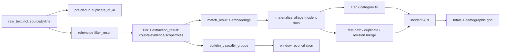

# Casualty data-flow recon (read-only)

**Scope.** Recon performed 2026-10-14 against the checked-out source and the
`war_news_dev` database. No application data, migrations, prompts, rules, or
frontend files were changed. The trace helper is SELECT-only. `alembic heads`
and `alembic current` both report `20261008_0079 (head)`.

## 1. Summary

1. Casualty values have two meanings in the schema: `deaths`/`injuries` are
   local/reportable values, while `total_deaths`/`total_injuries` are roll-up
   values. The UI filters and headline presentation use totals, not local
   values.
2. The current split Tier-1 flow grounds non-null counts with `evidence_span`
   and makes scope deterministically; legacy/default extraction payloads in the
   database do not consistently have either.
3. Case 4 proves the 12/10 display was not produced by its stored extraction:
   raw 30033 extracted 9 deaths/5 injuries, but incident
   `711adf5b-5d46-4a5c-8e21-1554c7d975b1` stores 12/10. Other matching source
   rows extract headline 11/5, making cross-message merge/roll-up the first
   remaining place to audit.
4. Case 5 proves demographic and total fields can diverge. Raw 31308 holds
   `male_deaths=2,total_deaths=2,total_injuries=5`; its two materialized rows
   have either deaths-side demographic data or injury data, with null totals.
5. Page/channel bylines are present in `raw_text` and are passed as text to
   extraction; raw 28404 starts `صفحة الإعلامي الشهيد علي شعيب`. This is a
   genuine false-positive surface for the word `الشهيد`.
6. Aggregate bulletin handling is now represented by
   `bulletin_casualty_groups` plus a reconciliation worker, rather than
   copying a shared toll to every village. Existing/legacy rows remain a
   historical-data risk.
7. The workspace has a dirty worktree unrelated to this recon; it was left
   untouched. The running backend image is older than the checkout, so the
   helper was copied into the container only to execute the requested
   read-only trace (the repo copy is authoritative).

## 2. Pipeline map

| Stage | entry point | casualty read -> write | provenance / risk |
|---|---|---|---|
| Ingest | `app/sources/services/red_alert_collector.py`; `RawMessage` model `app/news/models/raw_message.py:38` | source text/payload -> `raw_text`, `raw_payload`, `cnrs_classification` | Raw source, including bylines. |
| Pre-extraction dedup | `app/news/services/dedup/pre_extraction_dedup.py:89,133` | no count parsing; `duplicate_of_id` can redirect ownership | deterministic; linked message can surface another row’s incident. |
| Relevance | `app/llm/actions/filter_relevance_action.py`; worker `pipeline_llm_workers.py:39` | text -> `filter_result` | LLM/CNRS classification; no count write. |
| Tier 1 | `pipeline_llm_workers.py:39`; `ollama_extraction_service.py:173`; split path `split_phase_extraction.py:324,737` | text -> `extraction_result.casualties`, evidence, transitions, scope, village roles | LLM then deterministic evidence/count/scope/gender backstops. |
| Tier 2 | `pipeline_llm_workers.py:158`; `tier2_detail_fill_service.py`; `merge_detail_fill.py` | category `casualties` -> incident detail/category fields | LLM detail fill; category roll-up must not double-count root. |
| Embedding/matching | `raw_message_embedding_service.py`; matcher services | none -> `content_embedding`, `match_result.village_matches` | deterministic/model embeddings; controls which incident receives values. |
| Fast path/materialize | `incident_materialization_service.py:316,431,591,2215,2247` | extraction/village role -> `Incident.deaths`, `injuries`, totals, demographic fields/status | copies root values only where scope permits; creates bulletin group for aggregate scope. |
| Duplicate/revision merge | `incident_repository.py:1654`; `incident_merge_service.py` | existing + incoming -> merged incident and `incident_updates` | guard suppresses aggregate counts; transitions and clean-increase logic can change count ownership. |
| Bulletin reconciliation | `bulletin_reconciliation_service.py:39,127` | group + later per-village extraction -> incident fields/group status | deterministic reconciliation, then flags. |
| Summary path | `summary_bulletin` models; migrations `20261008_0076..0078`; `summary_reconcile_sweep.py` | summary items -> summary-origin incidents/decisions | summaries explicitly avoid writing casualty numbers in frontend copy. |

## 3. Data model and prompt inventory

| Store / DTO | casualty fields | writers -> readers |
|---|---|---|
| `raw_messages` (`raw_message.py:38`) | JSONB `filter_result`, `extraction_result`, `match_result`, `raw_payload`; `duplicate_of_id` | workers -> materializer, matching, recon. |
| `incidents` (`incident.py:46`) | nullable integer `deaths`, `injuries`, `total_deaths`, `total_injuries`; nullable `martyrs`, `moh`, `note_extra`; status/evidence JSONB fields and `verification_reason` | materializer/repository/reconciliation -> API/UI. No `casualty_updated_at` exists in model or migrations. |
| `incident_details` | category demographic values | Tier 2/edit service -> repository DTO. |
| `incident_updates` | JSONB `old_values`/`new_values`, including scope/provenance | merge/materializer -> audit/recon. |
| `bulletin_casualty_groups` (`bulletin_casualty_group.py:22`) | scope enum, village ids JSONB, nullable totals, lifecycle fields | materializer -> reconciliation/API DTO. |
| DTOs | `ExtractionResult`, `ExtractionCasualties`, `VillageRoleEntry`, `ExtractionSubEvent`, `CasualtyCountEvidence` in `extraction_dto.py:76-231`; incident DTOs in `app/news/dtos/incident_dto.py` | serialization boundary. |

Tier-1 schemas are declared in `ollama_extraction_service.py:173-428`; split
casualty schema is at `split_phase_extraction.py:187-245`. Both request count
fields; split calls require `field,evidence_span`, and per-village entries
require `village,deaths,injuries,evidence_span`. Rules are
`app/core/llm_knowledge/rules/combined_tier1_prompt.md`,
`tier1_general_prompt.md`, and `tier1_multi_village.md`; gender terminology is
`app/core/llm_knowledge/terminology/casualty_gender.yaml`. Extraction receives
the saved message text, not a separately excluded byline; case 1 establishes
that the byline is inside that text.

`alembic heads/current`: `20261008_0079 (head)`. Casualty-related migrations
include `20260909_0055_add_bulletin_casualty_groups.py`,
`20260928_0069..0071`, and merge `20260924_0068`; no unapplied casualty
migration was found. The requested historical duplicate head
`20260811_0004` is not a current head; preserve it as an ancestry audit item.

## 4. Case traces

The helper is [trace_casualty_cases.py](../../scripts/recon/trace_casualty_cases.py).
It imports the application session and issues ORM `SELECT`s only. The supplied
first snippet is a channel header shared by 879 rows, so it is not a unique
identifier; exact target IDs for case 1/2 require a date, source, or incident
ID before claiming a single causal chain.

| Case | evidence and first demonstrated failure |
|---|---|
| 1 Chaqra/page header | Raw 28404 shows the full source header in `raw_text`, while its persisted extraction has all casualty values null. Thus the inspected representative does **not** reproduce the claimed male=1; the header is demonstrably in LLM input, but the exact bad raw/incident is ambiguous from the supplied non-unique snippet. |
| 2 summary | The supplied summary heading is also non-unique. No unique raw/incident chain can be responsibly attributed. The current summary UI states summaries never write casualty numbers (`frontend/src/features/summaries/components/SummaryResolveForm.tsx:101`); the claimed 11 must be traced with an exact record ID through legacy/live materialization. |
| 3 MoH/Maslakh | Query found raw 32756 -> incident `a876b81c-b70e-4b20-a14a-84c7557d3c78`: incident 1 death/9 injuries but its extraction root is 1 death and null injuries. Raw 32767 maps separately to 1 death. This is cross-location/root leakage or merge attribution, not a single exact per-village extraction. |
| 4 Kfarroumane | Raw 30033 extraction is **9/5**; linked incident `711adf5b-5d46-4a5c-8e21-1554c7d975b1` is **12/10**. Other matching raws 31169/31177 extract **11/5**. Therefore wrong values first appear after extraction, at materialization/duplicate merge/roll-up. The extra 3 deaths and 5 injuries require inspecting that incident’s `incident_updates`/duplicate links; no code evidence supports calling 11+9=12, so the stated arithmetic cause remains open rather than guessed. |
| 5 Kfarroumane/Arabsalim | Raw 31308 has `male_deaths=2,total_deaths=2,total_injuries=5`. It materializes two rows: village 118 with null totals and village 851 with injury 5/null totals. The first wrong state is the source extraction’s demographic/total mix, then `_casualties_for_village`/field mapping fails to carry total deaths to a row. Gender backstop (`casualty_gender_evidence.py:104-150`) can infer explicit masculine singular/dual forms but must not infer gender from generic plural grammar. |

## 5. In-flight work status

| Item | status | evidence / missing |
|---|---|---|
| scope + deterministic backstop | implemented | DTO + `casualty_scope_backstop.py:77`; legacy rows lack fields. |
| bulletin group + worker | implemented | model, migration 0055, reconciliation service. |
| `is_multi_village` correction | partial | split flow operates per segment; no canonical `is_multi_village` field located. |
| village count/evidence + fallback | implemented | `VillageRoleEntry`; materializer lines 2215/2247. |
| replace blind max wins | implemented/verify history | `merge_existing` calls guard; audit historical max-wins records. |
| LLM diff -> `note_extra` | partial | field exists; no universal diff writer located. |
| `casualty_updated_at` | not started | no hit in app/migrations. |
| verification helper/backfill | partial | verification signals/reasons exist; no named complete backfill found. |
| toll revision + widened search | partial | story/revision routes exist; broader historical proof pending. |
| Arabic gender | implemented | terminology + evidence backstop. |
| summary larger-model/window reconcile | partial | window reconciliation exists; model-selection proof not found. |

## 6. API and frontend

`GET /incidents` and `GET /incidents/{id}` are in
`app/api/incidents_router.py:74,191`; repository projection is in
`incident_repository.py:410,716`. The list’s `has_casualties` query and client
fallback use `(total_deaths ?? 0) > 0 || (total_injuries ?? 0) > 0`
(`incident_repository.py:2861`, `frontend/src/features/news/hooks.ts:54`).
Detail renders demographics and totals at
`IncidentDetailPage.tsx:528-569`; `null` becomes “No data”, while zero renders
as zero. “Reported” is the list aggregate based on total fields, not a separate
casualty source. Related incidents are returned through duplicate/story
relationships. `IncidentBulletinRow.tsx:76-79` treats null totals as zero,
therefore calls a null/null row “no casualties”. No active mock hook was found
for these views under `frontend/src/mocks/`.

## 7. Scenario coverage matrix

| scenario | current behaviour / gap | files |
|---|---|---|
| 1 exact single village | root copied to row; sound when evidence exists | materializer 2215 |
| 2 word/no number | status/flag path; may need review | casualty status services |
| 3 non-casualty word | header still enters text; false positive risk | raw model; Tier 1 rules |
| 4 several villages, separate tolls | split path assigns per segment | split flow 737 |
| 5 shared toll | aggregate group, not per-village | materializer 2279 |
| 6 no village toll | unspecified/aggregate review | scope backstop 77 |
| 7 headline/body conflict | source extraction can select either; no documented precedence | case 4 |
| 8 same event/same values | fast dedup/merge | repository 1654 |
| 9 same event/different values | guard/revision/verification; historical values need audit | merge guard |
| 10 later higher toll | revision route exists, coverage partial | materializer/repository |
| 11 injured dies | transition model and merge | DTO; repository 1678 |
| 12 recovery later | no explicit recovery parser located | open gap |
| 13 summary bulletin | separate summary flow; must not assign numbers | summary components |
| 14 demographics | explicit Arabic backstop; plural ambiguity intentionally withheld | gender evidence |
| 15 groups/occupations | occupation evidence supports gender but not all group semantics | gender evidence 172 |

## 8. Tests

Attempted standard command: `docker compose exec backend sh -lc "PYTHONPATH=/app pytest -q"` on 2026-10-14. It returned no summary before the execution window, so no pass/fail count is claimed. Relevant tests include `test_tier1_split_flow.py`, `test_tier1_split_casualty_presence.py`, `test_tier2_detail_fill.py`, `test_village_role_materialization.py`, `test_verification_reason_precedence.py`, and verification-flag tests. No dedicated regression test was located for page-name false positives, headline/body conflict, recovery, or the five exact database cases.

## 9. Every copy / merge / default point

1. Tier-1 copies LLM count JSON into `ExtractionResult`; count backstop drops or fills only evidence-grounded values.
2. Split aggregation sums per-segment root counts (`split_phase_extraction.py:737`) and maps village entries.
3. Materializer chooses unit counts or `_casualties_for_village`; root fallback is in `_root_casualties_for_village` (2215/2247).
4. Category detail fill can copy category casualties; suppression prevents category/root double count.
5. Fast-path duplicate matching links messages and may merge a candidate.
6. `IncidentRepository.merge_existing` combines incoming/existing values, transitions, statuses and audit JSON; aggregate scope is suppressed by `casualty_merge_guard.py:15`.
7. Bulletin reconciliation writes later exact counts into grouped incidents and retains/clears aggregate status.
8. Frontend converts `null` totals to zero for filtering/compact text; detail instead shows “No data”.

## 10. Open questions

- Which exact raw IDs/incidents are intended for cases 1 and 2? The supplied Arabic snippets are non-unique headers.
- Which `incident_updates` and duplicate-match records produced case 4’s 12/10?
- Is the dashboard screenshot from this database revision and current frontend build?
- Should a generic masculine plural ever populate `male_*`? Current code deliberately says no.
